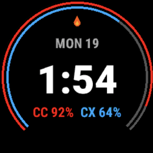
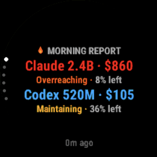
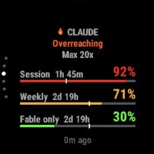
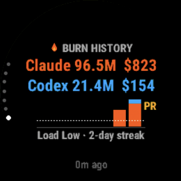

# Token Burn 🔥

**Feel the Token Burn.**

Your watch already knows when you have overdone it on the bike; now it knows when you have overdone it in Claude Code.
Plan limits drain like Body Battery, a reset is recovery time, and three back-to-back refactors before lunch earn you an **Overreaching** warning.
Beat your biggest day and it buzzes with a personal record, priced in dollars burned like calories.
Take a week off and it will tell you, gently, that you are **Detraining**.

It is [CodexBar](https://github.com/steipete/CodexBar) on a Garmin Forerunner 255, because why not...

> **Unofficial project.** Token Burn is not affiliated with or endorsed by CodexBar, Garmin, Anthropic, OpenAI or any other provider it shows.

https://github.com/user-attachments/assets/d3539ccf-26ec-47a2-bc74-804d55a174c4

<p align="center"><em>The advert, 40 seconds: <a href="docs/media/video/token-burn.mp4">original cut</a> · <a href="docs/media/video/token-burn-stock.mp4">stock-footage cut</a> · <a href="video/README.md">how the film is made</a>.</em></p>

<p align="center">
  
  
  
  
</p>
<p align="center"><em>Claude is Overreaching again. Codex is Recovering. Cursor is Maintaining, mostly by being ignored.</em></p>

## How it's built

A script on your computer boils CodexBar's snapshot down to a small JSON file with [jq](https://jqlang.org/) and publishes it to a gist.
A [Connect IQ](https://developer.garmin.com/connect-iq/) app and watch face sync it through your phone every five minutes, like any other activity.

**Install: copy [`prebuilt/TokenBurn.prg`](prebuilt/TokenBurn.prg) and [`prebuilt/TokenBurnFace.prg`](prebuilt/TokenBurnFace.prg) to the watch's `GARMIN/APPS/` folder, then run `make publish` after each session.**

## Run locally

You need Java 11 or newer, curl, unzip, Python 3, OpenSSL, jq and ShellCheck.

```sh
make deps
make can-release
```

## Documentation

| Guide | What you'll find |
| --- | --- |
| [Using](docs/using.md) | The owner's manual: burn status, recovery time, personal records and alerts |
| [Installing](docs/installing.md) | Sideloading and pointing the watch at your snapshot |
| [Publisher](docs/publisher.md) | CodexBar, the config file and the snapshot format |
| [More guides](docs/README.md) | Providers, architecture, development, testing and screenshots |

## Credits and licence

Plan usage comes from [CodexBar](https://github.com/steipete/CodexBar) by Peter Steinberger.
Token Burn is released under the [MIT licence](LICENSE).
Film assets retain the licences and credits listed in [video/CREDITS.md](video/CREDITS.md).
It is not affiliated with or endorsed by CodexBar, Garmin or any provider it shows.
